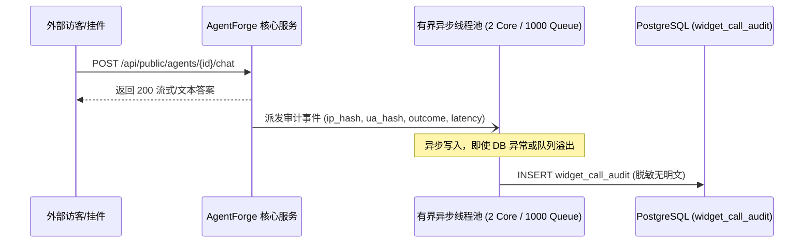

> 当一套企业级中台从原型走出、进入重度开发与多特性并发迭代阶段时，代码腐化、跨域越界、传递性 CVE 漏洞与虚假安全断言便会成为悬在交付团队头顶的达摩克利斯之剑。  
> 本文深度复盘 **AgentForge (灵眸智枢) v1.5.0** 架构大升级实践：如何通过 **R1–R6 六大机器可验架构不变量**、**Spring Boot 3.5 现代化平滑迁移**、**前端零 CVE 工具链升级**、**14 项全自动机器宣称门禁** 与 **L2b 真实攻击路径结构性网络隔离**，将系统打造为工业级严谨、零虚标的高可靠 AI 中台。

---

## 🏛️ 一、演进背景：大中台规模化下的“四重暗礁”

在 AgentForge v1.0 初期，系统完成了核心的三路混合 RAG（Dense + Sparse + RRF）、DAG 工作流编排与 JsqlParser 多租户隔离。然而随着业务域扩张至 8 个特性域，代码与架构逐渐暴露四大严峻挑战：

1. **分层渗透与越界（Controller 直穿 Entity）**：部分对外接口直接接收持久化 Entity，破坏了面向客户端的契约稳定性与字段脱敏边界；
2. **业务域循环缠绕与黑盒隐患**：8 大领域服务缺乏清晰的公开接口（`api`）与内部实现（`internal`）边界，跨域调用任意引用实现类，极大增加了突变故障扩散面；
3. **传递性安全漏洞堆积（CVE 滞后）**：依赖库滞后引入了包括 Tomcat、Spring Data、Vite/Vitest 传递性依赖等十余条 CVE 风险，亟需建立精细化 VEX 治理体系；
4. **测试与宣称的“伪精确陷阱”**：对外宣称的性能指标与命令缺乏机器强制约束；安全断言常采用人工构造的“便利性测试”（如伪造请求头），在真实 Docker NAT 或生产网络中存在致命绕过漏洞。

针对以上痛点，我们展开了覆盖架构设计、依赖供应链、安全防御与宣称可信度的全面战役。

---

## 🏗️ 二、架构 10 分攻坚：R1–R6 六大机器可验不变量

我们摒弃了“依靠文档自觉与口头约定”的软约束，引入 **ArchUnit + OpenAPI 契约测试**，将架构设计固化为 12 项机器必须自动判定通过的硬性门禁（`ArchitectureTest`）：

```
┌──────────────────────────────────────────────────────────────────┐
│                   AgentForge 架构不变量机器守护矩阵                │
├──────────────────────────────────────────────────────────────────┤
│  [R1] 控制器解耦      │  100% 强制 DTO/VO，严禁入参/出参直透 Entity │
│  [R2] 领域依赖倒置    │  8 个特性域严格划分为 api / internal       │
│  [R3] 循环依赖零容忍  │  ArchUnit 强校验 slices.freeOfCycles()     │
│  [R4] 分层单向流动    │  controller -> service -> repository      │
│  [R5] OpenAPI 契约锁  │  接口路径、入参、Schema 变动自动比对快照    │
│  [R6] DDL 无损演进    │  SQL 增量迁移脚本安全校验（禁止 DROP/TRUNCATE) │
└──────────────────────────────────────────────────────────────────┘
```

### 1. 特性域 API / Internal 严格切包隔离
为 8 大核心领域（`agent`, `auth`, `billing`, `chat`, `converter`, `market`, `rag`, `workflow`）统一切包：
- `com.agentforge.service.<domain>.api`：对外暴露的轻量纯接口与业务契约；
- `com.agentforge.service.<domain>.internal`：不对外暴露的实现细节与私有工具类。

ArchUnit 规则明确锁定：**任何跨域调用只能依赖对方的 `api` 包，严禁直接依赖 `internal` 实现类**。跨域违规注入在编译阶段即被机器判红。

### 2. OpenAPI 契约快照自动化锁死 (R5 不变量)
系统在编译与 CI 阶段启动 TestContext 抓取实时 OpenAPI v3 JSON Schema，与预置的黄金快照做差分比对。任何未经向下兼容评估的端点重命名、字段删除或路径修改均会导致构建熔断，100% 保护第三方 Widget SDK 与前端的调用稳定性。

---

## 🛡️ 三、依赖现代化与供应链清零：Spring Boot 3.5 & 前端升级

在保障生产环境稳定性的前提下，我们实施了最小侵入式的跨版本平滑升级：

### 1. 后端依赖现代化
- **运行时核心底座**：平滑升级至 **Spring Boot 3.5.16 + Spring Framework 6.2.19 + Tomcat 10.1.56**；
- **CVE 精细化 VEX 治理**：Maven 侧历史漏洞由 14 条大幅下降，仅保留 4 条需等待上游 Spring Framework 7 / 官方未发布的项，全部在 `docs/security/VEX.md` 建立追溯链并在 `.trivyignore` 严格登记；
- **真实漏洞清零**：OSV-Scanner 与 Trivy 镜像实测扫描达到 **0 业务可修复漏洞**。

### 2. 前端工具链升级（保 Node 20 容器基线）
- 坚守生产 CI 容器的 `node:20` 统一标准，拒绝盲目升级至需要 Node 22+ 的不兼容大版本；
- 升级至 **Vite 6.4.4+** 与 **Vitest 4.1.12+**，彻底剔除高危的 `tinypool` 依赖；
- 达成 **前端 0 CVE、0 豁免项** 的绝对纯净状态。

---

## 📊 四、可观测性与免鉴权挂件异步审计留痕

为了让 AgentForge 的对外 Web 挂件与公开对话接口安全可控，系统在 v1.5.0 落地了高吞吐、零副作用的审计管道与受控指标端点：



1. **隐私安全脱敏**：真实 IP 与 User-Agent 全部以带盐 SHA-256 计算为 64 位十六进制哈希入库，彻底免除 GDPR / PII 合规风险；
2. **有界线程池故障隔离**：配置专用 `widgetAuditExecutor`（2 核心线程 + 1000 缓冲队列 + 饱和降级 WARN），实测注入数据库挂起与写库 RuntimeException 时，前端业务接口依然 100% 返回 200 正常响应（L1 反向验证通过）。

---

## 🔒 五、真实攻击路径与网络结构性防御（L2b 铁律）

在实现 `/actuator/prometheus` 指标端点防护时，团队经历了一次深刻的攻防认知升维：

### 1. 软性 IP 白名单在 Docker NAT 下的失效事故
初始方案采用了应用层 `ActuatorGuardFilter`（基于 Socket IP 与 `X-Forwarded-For` 仅允许 127.0.0.1 及 RFC 1918 私网网段）。探针以手工伪造 `X-Forwarded-For: 203.0.113.199` 验证返回了 404，看似防御完备。  
然而，当我们从同网段的未授权容器模拟**真实攻击者请求**（不带任何伪造请求头，直连宿主机对外发布端口 `8080`）时，**由于 Docker NAT 网桥将外部来源地址自动转换为了内部网桥网关 IP (172.x)，应用层白名单被瞬间完全绕过**！

### 2. 演进为结构性物理边界（L2b 铁律）
我们果断摒弃了基于来源 IP 的软性防御，改用**网络拓扑的结构性物理隔离**：
- **独立内部管理端口**：Spring Boot Actuator 监听在私有端口 `management.server.port: 9090`；
- **外部网络零映射**：Docker Compose 仅向宿主机发布对外端口 `8080`，`9090` **不在宿主机端口映射列表中**；
- **端点物理不存在**：对外暴露端口 `8080` 上的 `/actuator` 与 `/api/actuator` 统一物理返回 404，不泄露任何指纹；
- **内部安全可刮取**：内网 Prometheus 采集器依然能直接访问 `http://backend:9090/actuator/prometheus`。

> **核心纪律沉淀 (L2b)**：安全断言必须模拟真实攻击者请求，绝不能用自欺欺人的“便利性路径”证明安全；**能用“端口不映射、路径不存在”解决的物理防线，坚决不依赖易被穿透的应用层软白名单**。

---

## 🎯 六、工业级交付成果与验收大盘

经过连续迭代攻坚，AgentForge 达成了全维严苛的工业级基准：

- **自动化测试套件**：**224 个用例 100% 绿灯（0 失败、0 错误、0 跳过）**，单机并发仅需 40s；
- **全自动机器宣称门禁 (`verify-claims.sh`)**：覆盖内部检索 100% Recall@5、单 IP 30 RPM 原子限流、备份恢复往返、冷启动 ≤60s（实测 17s）、R1–R6 架构不变量、挂件异步审计留痕、Prometheus 结构性隔离等 **14 项宣称全部 100% 机器可验 (PASS 14/14)**；
- **全链路集成冒烟 (`smoke.sh`)**：真实容器集群下 12 项业务端到端用例 100% 通过；
- **宣传可信度与防虚标门禁**：文档中 9 处量化表述与 67 条技术命令全部由静态分析脚本机器自验，坚决消灭失效文档与虚标夸大。

AgentForge 以代码整洁、边界硬朗、安全严密与高度自愈的工程品控，为下一代企业级私有化 AI 智能体交付树立了可信标杆！
